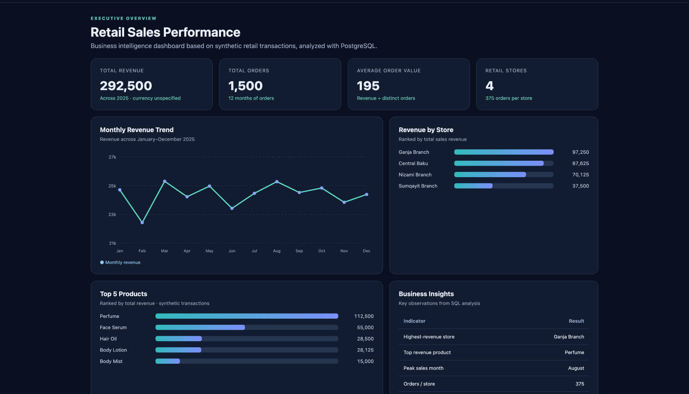
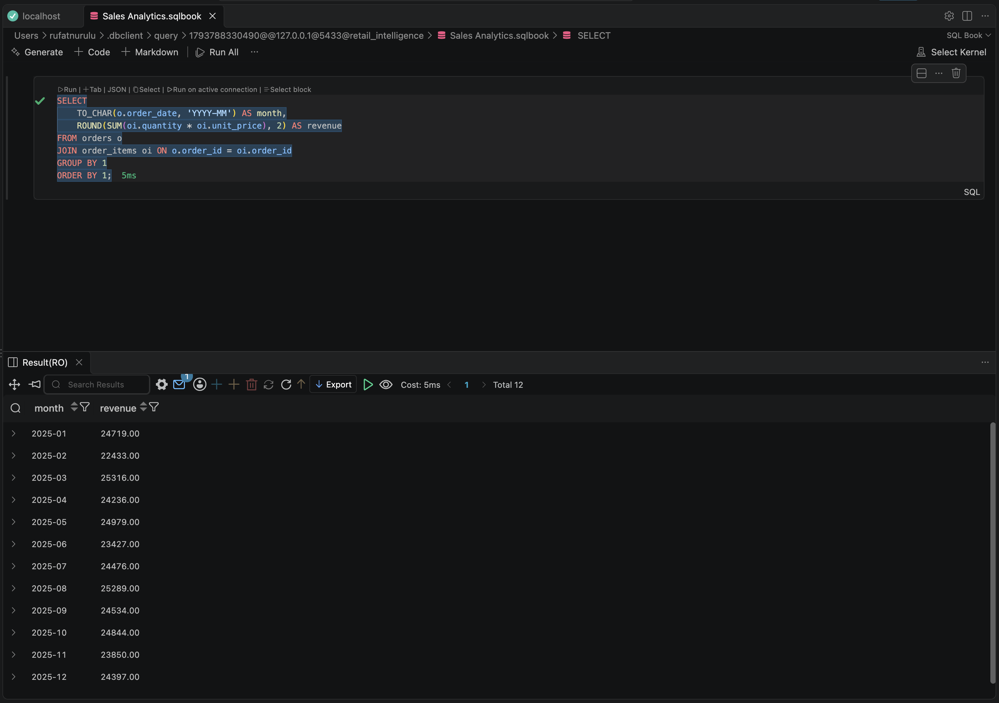
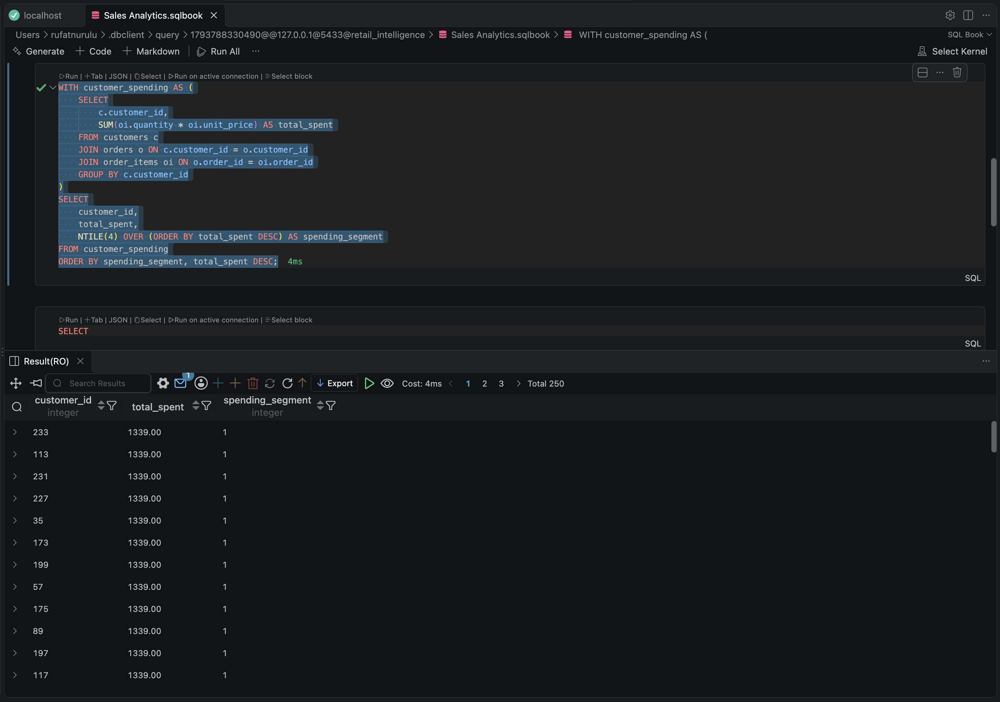
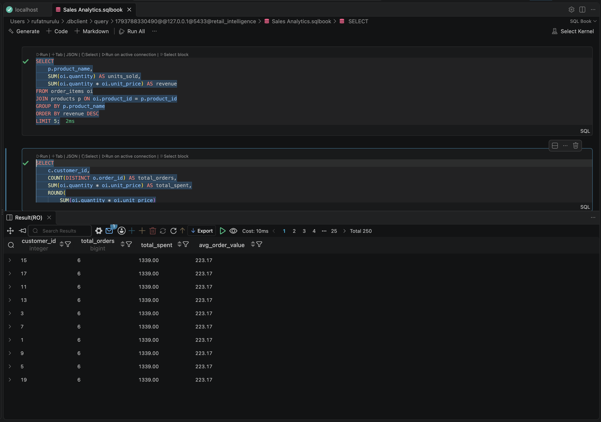
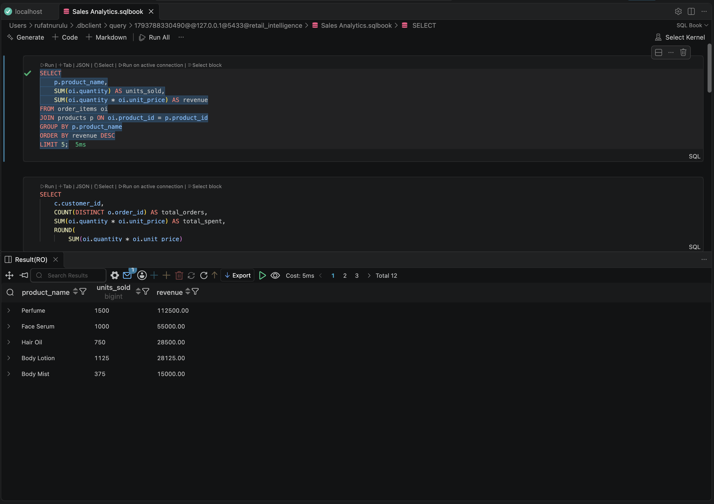

# Retail Sales Intelligence & Analytics Dashboard



## Project Overview

A retail sales analytics portfolio project built using PostgreSQL, SQL, HTML, CSS, and JavaScript.

The project analyzes synthetic retail transactions and presents key business insights through a web-based dashboard.

## Technologies Used

- **Database:** PostgreSQL 18
- **Data Analysis:** SQL
- **SQL Techniques:** JOINs, CTEs, GROUP BY, Aggregate Functions, Window Functions
- **Development Tools:** VS Code, pgAdmin 4
- **Frontend:** HTML, CSS, JavaScript
- **Version Control:** GitHub

## Dataset Overview

The database contains synthetic retail data for 2025.

| Metric | Value |
|---|---|
| Total Orders | 1,500 |
| Customers | 250 |
| Retail Stores | 4 |
| Total Revenue | 292,500 |
| Average Order Value | 195 |
| Reporting Period | January–December 2025 |

*Revenue is reported in unspecified currency units.*

## SQL Analytics

### 1. Monthly Revenue Analysis
- Monthly sales trends
- Revenue aggregation
- Sales performance over time

### 2. Product Performance
- Top 5 products by revenue
- Units sold per product
- Product revenue ranking

### 3. Customer Analytics
- Total spending per customer
- Purchase frequency
- Average order value

### 4. Customer Segmentation
- Customer spending analysis using CTEs
- NTILE() window function
- Spending-based customer segments

### 5. Store Performance
- Revenue by store
- Order volume by location
- Store-level performance comparison

## Dashboard Features

The interactive web-based dashboard includes:

- Total Revenue KPI
- Total Orders KPI
- Average Order Value KPI
- Monthly Revenue Trend
- Revenue by Store
- Top 5 Products
- Business Insights

The dashboard uses precomputed SQL analysis results and does not require a live PostgreSQL connection.

## Dashboard Screenshot


## SQL Execution Screenshots

### Monthly Revenue


### Customer Segmentation


### Customer Analytics


### Top Products


## Project Structure

```text
retail-sales-sql-analysis/
|
|-- 01_database_setup.sql
|-- 02_analytics.sql
|-- monthly_sales.csv
|-- index.html
|-- dashboard.png
|-- 01_monthly_revenue.png
|-- 02_customer_segmentation.png
|-- 03_customer_analytics.png
|-- 04_top_products.png
|-- README.md
```

## Key Business Insights

- **Highest-Revenue Store:** Ganja Branch
- **Top-Performing Product:** Perfume
- **Peak Revenue Month:** August 2025
- **Total Orders Analyzed:** 1,500
- **Total Revenue:** 292,500

## How to Run

1. Install PostgreSQL and pgAdmin.
2. Create a database named `retail_intelligence`.
3. Execute `01_database_setup.sql` to create and populate the tables.
4. Execute `02_analytics.sql` to run the analytical queries.
5. Open `index.html` in a browser to view the dashboard.

## Project Limitations

- The dataset is synthetic and intended for educational use.
- The dashboard displays static analytical results rather than live database updates.
- Some customer spending values repeat because of the synthetic data generation method.

## Author

**Rufat Nurulu**

Information Technology Student  
Azerbaijan State University of Economics (UNEC)

**GitHub:** https://github.com/rufatnurulu
